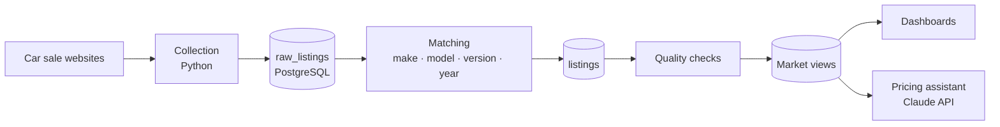

# InfoCars pricing showcase

InfoCars was a pricing tool for used-car dealers in Brazil. It collected car ads from sale websites, matched each one to a standard make, model, version and year, and showed dealers what comparable cars were listed for and how long they took to sell. A chat assistant answered pricing questions in plain language.

I built it at Informar Dados in 2025 and sold it to a car dealer. This repository is a **rebuilt sample** written for my portfolio. It shows how the main parts worked, using synthetic data. It does not contain the production code, real listings or the scraper.

## Results in production

| | |
|---|---|
| Listings in the database | about 250,000 |
| Model spellings after cleanup | 5,114 reduced to 641 real models (26,071 ads corrected) |
| Saving per negotiation at the dealer | about R$ 2,000, comparing the dealer's figures before and after adoption |
| Time in stock at the dealer | down to 1–3 months |

## How it worked



**1. Matching ads to a catalogue.** Sellers write the same car in many ways: "Onix 1.0 LT", "GM ONIX LT 22/23", "onix lt flex". Without a single name per car, a price comparison means nothing. [`infocars/normalize.py`](infocars/normalize.py) cleans the text, matches aliases on whole words (so "LT" never matches "LTZ"), reads the model year from "22/23", and falls back to fuzzy matching for typos such as "Corola" or "Platinun".

**2. Quality checks.** Ads are dropped when the price is missing, out of range, or far from comparable cars. A common error is a price typed without its last digit, which still looks like a valid car price. See `_drop_price_outliers` in [`infocars/db.py`](infocars/db.py) and the PostgreSQL version in [`sql/postgres/03_quality_checks.sql`](sql/postgres/03_quality_checks.sql).

**3. Market statistics.** For each version, year and state: median asking price, 25th and 75th percentiles, and median days on the site. An ad that disappears is treated as sold on its last day online. In production these were materialised views ([`02_market_views.sql`](sql/postgres/02_market_views.sql)).

**4. Pricing assistant.** The assistant went through three designs. It started with OpenAI and Grok models calling fixed functions, then moved to a SQL agent, and finally to the Anthropic Claude API with tool use, chosen after comparing the models with a test suite. [`infocars/assistant.py`](infocars/assistant.py) shows the final design:

- Three tools: `market_price`, `price_position` and a guarded `run_sql`.
- The system prompt and tool definitions are marked for prompt caching, since they are identical on every call.
- SQL written by the model goes through [`infocars/sql_guard.py`](infocars/sql_guard.py): one SELECT only, approved tables only, no comments, row limit added. In production it also ran under a read-only database role ([`04_assistant_role.sql`](sql/postgres/04_assistant_role.sql)).

## Run it

Python 3.9 or newer.

```bash
pip install -r requirements.txt
python scripts/demo.py
pytest
```

Output of the demo on the sample data:

```
Data quality
  raw listings:                1200
  dropped for bad price:       15
  dropped as price outliers:   18
  dropped, no full match:      0
  matched to the catalogue:    1167 (187 through typo correction)
  make/model spellings in ads: 116 -> 7 models

Market for a 2023 Chevrolet Onix LTZ, all states
  comparables: 6
  median_price_brl: 68400
  ...

A dealer asking R$ 89,900 for the same car
  above market, 21500 BRL from the median
```

To ask the assistant a question, copy `.env.example` to `.env`, add your Anthropic API key, export it, and run:

```bash
python scripts/demo.py --ask "Is R$ 89,900 a good price for a 2023 Onix LTZ in São Paulo?"
```

## Repository layout

```
infocars/
  catalog.py       canonical makes, models, versions and their spellings
  normalize.py     matching ads to the catalogue
  db.py            demo database (SQLite), quality checks, market statistics
  sql_guard.py     checks for model-written SQL
  assistant.py     Claude tool-use loop with prompt caching
sql/postgres/      production-style schema, market views, quality checks, read-only role
scripts/           sample data generator and demo
data/              1,200 synthetic listings
tests/             matching, SQL guard, market statistics, assistant loop with a fake client
```

## About the data

Everything in `data/` is generated by [`scripts/generate_sample_data.py`](scripts/generate_sample_data.py) with a fixed seed. Prices, mileage and dates are invented, and the titles copy the kinds of mistakes found in real ads. The demo uses SQLite so it runs without a database server; the files in `sql/postgres/` show the production design.

## Author

Guilherme Rigonato, BI engineer. [LinkedIn](https://www.linkedin.com/in/guilherme-rigonato-b41463116)
